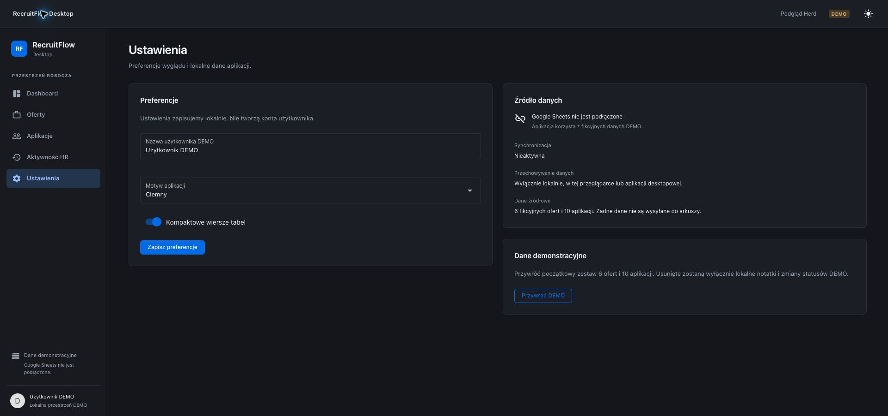

# RecruitFlow Desktop

**An offline-first macOS application for managing job opportunities and recruitment processes.**

Built with Laravel 12, NativePHP Desktop 2, Vue 3, TypeScript and Quasar.
RecruitFlow keeps offers, applications and recruitment history in local SQLite,
with optional Google Sheets synchronization, email integrations and AI providers.

This is a personal portfolio project by **Szymon Pokusiński**, demonstrating
backend architecture, desktop integration, typed frontend development and data
integrity across local and external systems. The domain supports different
professions; IT-specific requirements are optional attributes.

**Review the project:** [Architecture](#engineering-decisions) ·
[Source code](#code-map) · [Local setup](#run-locally) · [Tests](#tests) ·
[Implementation scope](#scope-and-limitations)



*An earlier demonstration build. The screenshot contains synthetic data; current
screens include additional recruitment and integration features.*

## What the application does

- **Offer inbox:** search, filters, sorting, favorites and interest levels. Offers
  with a sent CV are separated from opportunities awaiting action.
- **Manual offer management:** quick URL-only drafts or detailed forms with
  structured salary, location, requirements and custom attributes.
- **Recruitment tracking:** record a sent CV, change stages, use a Kanban board
  and maintain a chronological event history.
- **Offline persistence:** local changes survive restarts without a Google account.
- **Configurable Google Sheets sources:** OAuth with PKCE, automatic schema
  detection, column mappings, local cache, outbox and conflict handling.
- **Offer import:** preview public Pracuj.pl listing data in an editable form
  before saving. Source failures are reported; access controls are not bypassed.
- **AI integration:** interchangeable Cursor and Gemini drivers share one typed
  result contract. Category prompts, scheduled scans and deduplicated findings
  are independent of the provider.
- **Email workspace:** configurable accounts, Gmail/IMAP adapters, incremental
  synchronization, classification rules and on-demand message content retrieval.
- **macOS integration:** native windows and menus, Swift WidgetKit extension,
  local snapshots and deep links back into the desktop application.

## Engineering decisions

| Concern | Approach |
|---|---|
| Local source of truth | SQLite; transactional domain changes and durable outbox |
| External synchronization | Stable record identifiers, field mapping and explicit conflict resolution |
| Secrets | macOS Keychain where available; configuration examples contain no credentials |
| Frontend | Vue Composition API, strict TypeScript, Inertia navigation and Quasar components |
| Provider independence | Contracts, resolvers and normalized DTOs for AI and integration adapters |
| Import safety | Fetch/parse/normalize/preview are separate from the final save operation |
| Native widgets | A versioned snapshot boundary separates WidgetKit from Laravel storage |
| Verification | Laravel tests, HTTP fakes, frontend tests, type checking and production builds |

Business rules live in backend services and frontend domain modules rather than
being embedded in view components. AI findings do not automatically become
accepted offers or overwrite user preferences.

### Local writes and external synchronization

A user action is validated and saved locally before any external API call.
Related domain records and outbox operations are created transactionally, so
an unavailable network does not turn a successful local save into a failed action.
Synchronization compares stable identifiers and mapped fields, preserves Sheets
formulas and surfaces conflicts instead of treating every change as last-write-wins.

### AI as an adapter boundary

`AiProviderInterface` exposes search, analysis and capabilities. Cursor and Gemini
translate their transport formats into `AiResult`; shared validation rejects
invalid results before persistence. Category scanning owns prompts, run history
and deduplication, allowing provider changes without rewriting jobs or models.

### Useful entry points for code review

- [Local recruitment service](app/Recruitment/LocalRecruitmentService.php):
  transactional offer/application actions and history.
- [Outbox synchronizer](app/Integrations/OutboxSynchronizer.php): external writes
  separated from the user's local transaction.
- [AI contract](app/Services/Ai/Contracts/AiProviderInterface.php) and
  [category scanning](app/Services/Ai/Scanning/CategoryScanService.php).
- [Offer inbox rules](resources/js/domain/offerInbox.ts): deciding what remains
  actionable independently of the table component.
- [Widget snapshot boundary](app/Widgets/WidgetSnapshotPublisher.php): publishing
  data for a separate native extension.

## Code map

```text
app/
  Recruitment/              Local recruitment operations and synchronization
  Integrations/             Google OAuth, Sheets adapters and field mappings
  Services/Ai/              Provider contract, Cursor/Gemini, validation and scanning
  Services/Mail/            Email providers, synchronization and classification
  Models/                   Recruitment, integration, AI and email persistence
  Widgets/                  Snapshot publication and widget refresh
resources/js/
  Pages/                    Inertia page components
  components/               Reusable Quasar UI
  domain/                   Mapping, filtering and derived state
  services/                 Typed API access
  composables/              Shared application state and interactions
native/
  desktop/                  macOS packaging and deep-link bridge
  widgets/                  Swift / WidgetKit host and extension
tests/                      Backend, frontend and desktop bridge tests
```

## Run locally

Requirements: PHP 8.3+, Composer, Node.js 22.12+, npm and SQLite support.
NativePHP runs on macOS; building WidgetKit targets additionally requires Xcode
and your own Apple signing configuration. No API account is required for local
offer and application management.

From a **fresh clone**:

```bash
composer install
npm ci
cp .env.example .env
php artisan key:generate
touch database/database.sqlite
php artisan migrate
npm run build
```

For a browser preview, configure Laravel Herd for this directory and set
`APP_URL` in `.env` to your local URL, or run:

```bash
php artisan serve
```

For the desktop application:

```bash
php artisan native:install --no-interaction
php artisan native:migrate
php artisan native:run --no-dependencies
```

Do not overwrite an existing `.env` or recreate an existing database when updating.
Herd and NativePHP use separate SQLite files. Optional integrations require your
own credentials and permissions; they are not preconfigured in the repository.
AI scanning is opt-in and may incur provider charges.

## Tests

```bash
php artisan test --compact
npm test
npm run typecheck
npm run build
```

Tests cover local recruitment operations, stable identities and deduplication,
sync conflicts, formula preservation, provider mapping, retry behavior and
frontend filtering. Automated API tests use controlled fakes; they are not proof
of production API availability. Native signing, permissions and widget gallery
behavior require verification on a configured Mac.

Latest local verification (18 October 2026): **402 Laravel tests passed**
(2,903 assertions), **40 frontend/desktop JavaScript tests passed**, TypeScript
type checking and the Vite production build completed successfully. This verifies
the automated suite, not every external integration in a live environment.

## Scope and limitations

- This repository contains source code, not a notarized public macOS release.
- Google Sheets write paths require an explicitly writable source. Automated
  write tests do not certify a live production spreadsheet.
- Cursor and Gemini have automated contract/transport tests; live AI calls were
  not verified as part of the provider implementation.
- OLX import is not part of the published importer implementation. Any future
  access requires a separate permissions decision.
- External listing structures and API availability can change. Import errors
  remain visible rather than producing invented fields.
- This is an actively developed personal application; optional integrations have
  their own configuration and verification requirements.

## Documentation

- [Development and operational notes (Polish)](docs/DEVELOPMENT.md)
- [Google OAuth and integration setup](docs/google-oauth.md)
- [AI provider architecture](docs/ai/PROVIDERS.md)
- [Cursor driver](docs/ai/CURSOR.md) / [Gemini driver](docs/ai/GEMINI.md)
- [Category scanning and scheduling](docs/ai/SCANNING.md)
- [Pracuj.pl import research and limitations](docs/research/pracuj-pl/RESEARCH_REPORT.md)
- [macOS packaging](docs/desktop/INSTALLED_MACOS.md)
- [WidgetKit implementation](docs/widgets/MACOS_WIDGETS_IMPLEMENTATION.md)

Local databases, OAuth client files, API keys, snapshots and private exports are
excluded from version control. Screenshots and fixtures should never be used as
a way to publish a user's private recruitment data.

The checked-in NativePHP runtime is third-party code; its upstream notice is
preserved in [nativephp/LICENSE.md](nativephp/LICENSE.md). Application-specific
features are built on top of Laravel, NativePHP and the other listed frameworks.
